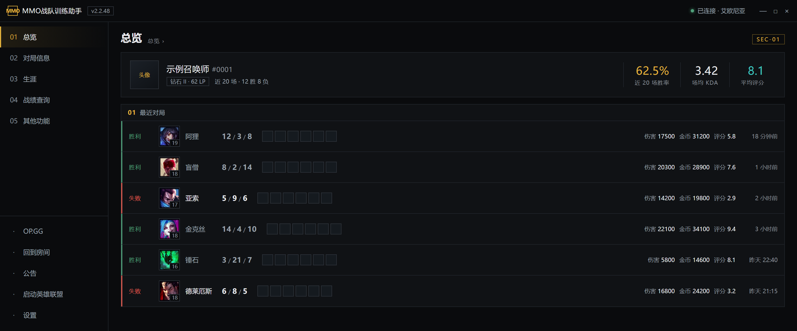
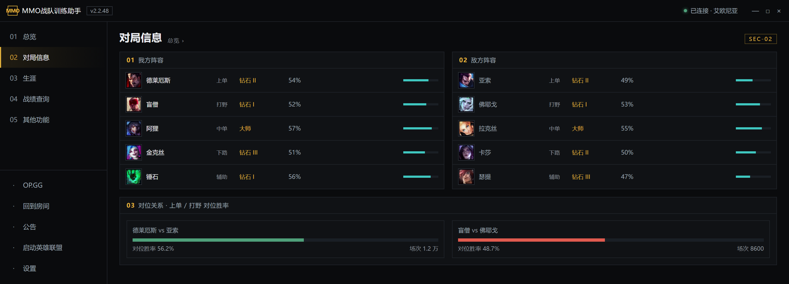
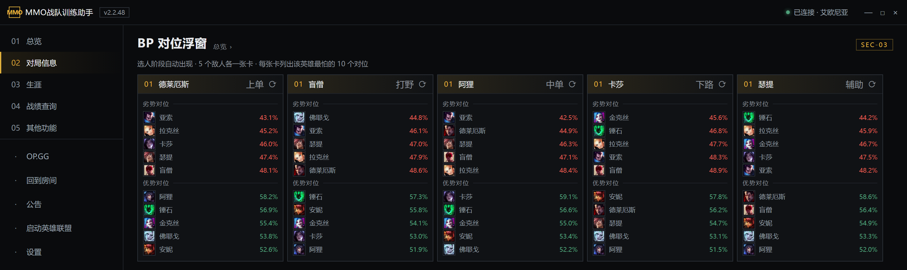
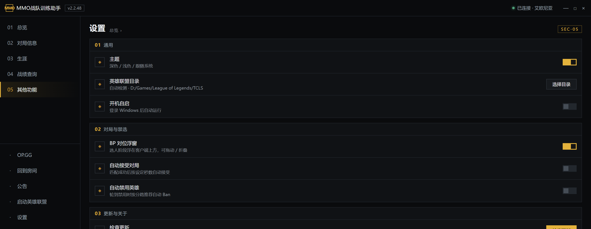

<div align="center">



# MMO战队训练助手

**英雄联盟战绩查询 · 对局信息 · 选人 BP 对位胜率助手**
League of Legends match history viewer & champion select (BP) assistant — 基于 LCU API 的 Windows 桌面应用

[](LICENSE)
[](#)
[](https://www.python.org/)
[](#)
[](#)

</div>

> **截图说明**：仓库里的界面图是**按真实界面复刻的设计稿**，所有召唤师名称、战绩、对位数据均为虚构示例，不含任何真实玩家信息。

---

## 这是什么

一款面向《英雄联盟》玩家的桌面助手。它**只读取官方客户端公开的本地接口**（LCU / Live Client Data / 公开战绩接口），把「这局队友和对手是谁、他们最近打得怎么样、我这一手英雄该怕谁」集中到一个窗口里，不用再切网页。

- **不读游戏内存，不注入 DLL，不加载驱动，不模拟键鼠** —— 详见 [安全与合规](#安全与合规)
- 绿色免安装，解压即用
- 深色 / 浅色双主题，可跟随系统

## 功能

| 模块 | 能做什么 |
| --- | --- |
| **总览** | 自己的段位、近 20 场胜率、场均 KDA、平均评分；最近对局一屏看完（英雄 / KDA / 伤害 / 金币 / 评分 / 时间） |
| **对局信息** | 十名玩家的英雄、段位、胜率一览；双方阵容对照，含**对位胜率**（上单打上单、打野对打野） |
| **BP 对位浮窗** | 选人阶段自动浮在客户端上方，**一个敌人一张卡**，每张卡列出该英雄最怕 / 最好打的 10 个对位；可拖动、可折叠、单卡刷新 |
| **生涯** | 任意玩家（含自己）的段位、常用英雄、近期表现、最近队友 |
| **战绩查询** | 按召唤师名 / 编号查人，带历史记录；双排、多排用同一颜色标注 |
| **其他功能** | 自动接受对局、自动接受换位 / 换英雄、自动选人、自动禁用、自动带召唤师技能、自动点赞、断线重连、锁定游戏配置、修复客户端窗口、一键观战 |
| **数据源** | OP.GG（韩服 / 国服可切）、101 榜单、官方版本公告；浮窗跟随数据源切换 |

<div align="center">

</div>

<div align="center">

</div>

<div align="center">

</div>

## 安装

### 方式一：直接下载（推荐）

到 [**Releases**](../../releases/latest) 下载：

- `MMO-Trainer-2.2.48-standalone.zip` —— 第一次用，解压到任意目录，双击 `MMO-Trainer.exe`，不需要装 Python
- `MMO-Trainer-2.2.48-update.zip` —— 已有旧版，拖进程序窗口即可更新

发布页同时给出两个包的 SHA256；杀软报毒时先核对哈希。

### 方式二：从源码运行

```bash
git clone https://github.com/gyw10086/MMO-Trainer.git
cd MMO-Trainer
pip install -r requirements.txt
python main.py
```

要求 Windows 10 / 11 + Python 3.11+，且本机已安装并能正常登录《英雄联盟》客户端。

## 安全与合规

这类工具最容易被误判成外挂，所以把边界写清楚：

| 会做的事 | 不会做的事 |
| --- | --- |
| 读取客户端进程的命令行，拿到本地 `--app-port` / `--remoting-auth-token` | 读写游戏进程内存 |
| 通过 `https://127.0.0.1:{端口}` 调客户端自己的 HTTP 接口 | 注入 DLL / 加载驱动 / Hook 图形接口 |
| 读取 `127.0.0.1:2999` 的 Live Client Data（官方提供的对局数据接口） | 模拟键鼠、向游戏进程发送输入 |
| 在**选人阶段**把浮窗贴在客户端窗口上（离开选人自动隐藏） | 在游戏画面里绘制任何内容 |
| 用玩家自己的 token 请求公开战绩接口 | 上传或留存任何账号凭据（token 不落盘、不进日志） |

- 自动化功能（自动接受 / 选人 / 禁用）**默认全部关闭**，需要主动打开；它们只是替你点一下客户端上本来就有的按钮。
- 仓库不含任何第三方可执行文件，安装包里也只有主程序本身。
- 如果杀毒软件报毒，请先核对发布页公布的 SHA256；一致即为误报，加信任即可。

## 常见问题

**Q：提示「需要管理员权限」？**
「修复客户端窗口」需要调整客户端窗口，而客户端通常以管理员身份运行，Windows 的 UIPI 会拦下普通权限进程。此时用管理员身份重启本程序即可。

**Q：浮窗不显示？**
浮窗只在**选人阶段**出现，且需要能拿到客户端窗口位置。客户端最小化或未登录时不会出现。

**Q：会不会封号？**
本项目不触碰游戏进程、不改变任何游戏行为，只读取客户端自己对外暴露的数据。但任何第三方工具都没有官方授权，请自行评估风险，尤其是自动化功能。

**Q：数据为什么和客户端里看到的不一样？**
战绩来自公开接口，存在缓存与延迟；分路判定走 SGP 的 `teamPosition`，极少数非常规分路可能识别不到。

## 技术栈

`Python 3.11` · `PyQt5` · `PyQt-Fluent-Widgets` · `qasync` · `aiohttp` · `LCU API` · `Live Client Data API`

```
app/
├── common/          主题、设计令牌、配置、日志、在线更新、窗口工具
├── lol/             LCU 连接器、SGP、OP.GG、101、分路判定、BP 对位
├── components/      战绩卡片、对局详情浮层、对话框等可复用组件
├── view/            各个页面与 BP 浮窗
└── resource/        图标、样式、字体
_dev_tests/          35 个离线测试脚本（不依赖客户端，可直接跑）
```

## 开发

```bash
python _dev_tests/test_positions.py    # 单跑，退出码 0 即通过
python -m compileall app               # 语法自查
```

测试全部是离线用例：不读写你的 `config.json`，不连接客户端，涉及窗口与系统调用的分支都做了替身。

## 致谢

界面与部分底层实现源自开源项目 **[Seraphine](https://github.com/Zzaphkiel/Seraphine)**（作者 Zzaphkiel，GPL-3.0）。本项目在其基础上做了大量重构与功能扩展（界面重做、BP 浮窗、对位胜率、分路判定、在线更新等），并按 GPL-3.0 继续开源。

数据来源：腾讯官方公开数据接口、OP.GG、101 榜单。

## 免责声明

本项目仅供学习与个人使用，与腾讯、Riot Games 无任何关联。使用本工具产生的任何后果（包括但不限于账号处罚）由使用者自行承担，请遵守游戏用户协议。

## License

[GPL-3.0](LICENSE)
